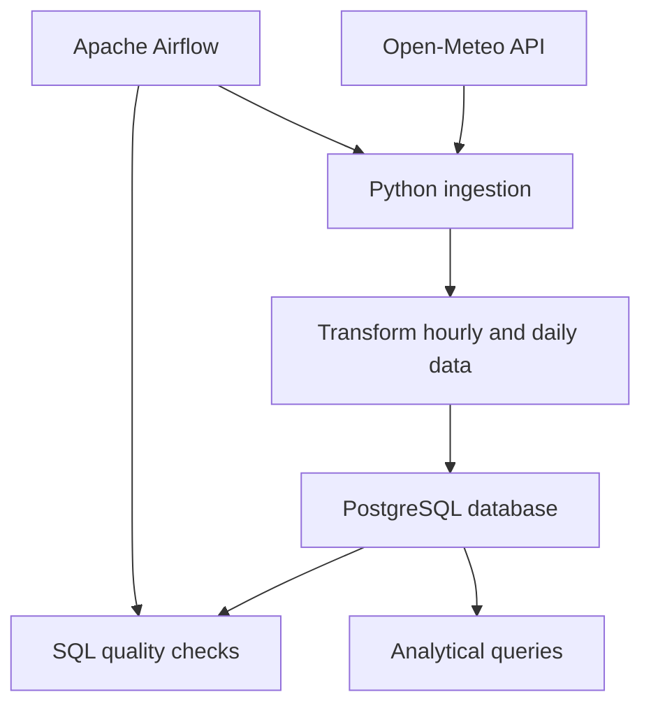
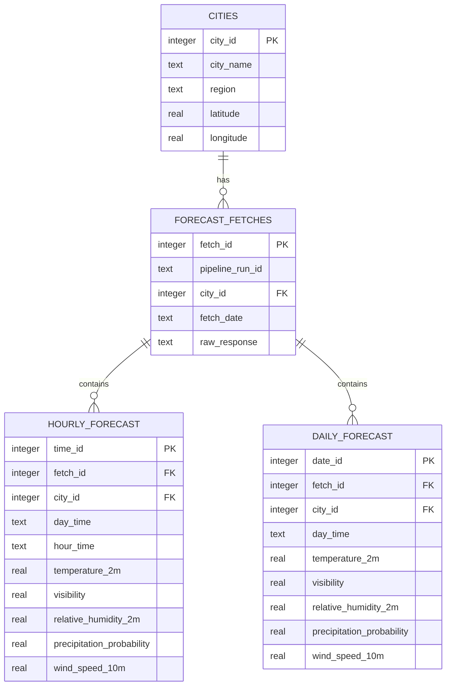

# Weather Data Pipeline


An end-to-end data engineering project that retrieves seven-day hourly weather forecasts from the [Open-Meteo API](https://open-meteo.com/), transforms the responses into hourly and daily datasets, and stores them in a relational PostgreSQL database.

The pipeline is containerized with Docker and orchestrated by Apache Airflow. Airflow schedules hourly ingestion runs and executes data-quality checks after each successful load.

## Project goals

This project was built to practise the core components of a data pipeline:

- extracting data from an external REST API;

- transforming nested JSON responses with Python and pandas;

- designing a normalized relational data model;

- preserving raw source responses for traceability;

- validating data with SQL-based quality checks;

- packaging application code in a Docker image; and

- scheduling and monitoring containerized tasks with Apache Airflow.

## Architecture



Airflow runs two sequential Docker tasks:

1. **`fetch_weather`** calls the API, transforms the response, and loads the database.

2. **`run_quality_checks`** runs SQL assertions against the most recent forecast for each city.

The DAG runs hourly, does not backfill historical intervals, and allows only one active DAG run at a time to keep ingestion and validation runs from overlapping.

## Data flow

For every configured city, the ingestion process:

1. Requests seven days of hourly forecast data from Open-Meteo.

2. Retains the complete API response as JSON in `forecast_fetches`.

3. Converts the hourly arrays into a pandas DataFrame.

4. Separates the forecast timestamp into date and time fields.

5. Inserts 168 hourly forecast rows.

6. Aggregates the hourly values into seven daily rows.

7. Commits all cities as a single database transaction.

If an exception occurs before the transaction completes, PostgreSQL rolls the load back. Each Airflow DAG run also passes its `run_id` into the ingestion container. A uniqueness constraint on `(pipeline_run_id, city_id)` rejects duplicate entries for the same Airflow run and city. This constraint alone does not make a retry automatically succeed.

## Data model



The diagram shows the logical fields and relationships. `create_tables.sql` is the authoritative source for PostgreSQL column types and constraints. The schema includes primary keys, foreign keys, uniqueness constraints, and range checks for weather measurements. PostgreSQL manages data storage separately from the application containers.

## Data-quality checks

After ingestion, the pipeline validates the latest forecast for every city. A quality check fails when its SQL query returns one or more rows.

| Check | Expected result |

|---|---:|

| Hourly record count | 168 rows per city |

| Daily record count | 7 rows per city |

| Forecast date range | 6 days between the first and last forecast date |

Checks are executed directly through psycopg cursors. Failed checks raise an exception, causing the corresponding Airflow task to be marked as failed and retried according to the DAG configuration.

## Analytical queries

The `queries/` directory contains reusable SQL analyses for questions such as:

- Which cities have the highest temperature tomorrow?

- What are the daily minimum, maximum, and average temperatures?

- Which cities experience the largest intraday temperature swings?

- How many hours per day have a precipitation probability above 50%?

- Which city has the best conditions for outdoor activities over the next three days?

- How did a forecast change between its two most recent API fetches?

- Which cities have the most volatile forecasts over time?

The queries use joins, common aggregations, conditional aggregation, window functions, and comparisons between successive forecast runs.

## Repository structure

```text
weather-pipeline/
├── airflow/
│   ├── dags/
│   │   └── weather_pipeline_dag.py
│   └── docker-compose.yaml
├── config/
│   └── cities.yaml
├── data_quality/
│   ├── forecast_days.sql
│   ├── number_records_daily.sql
│   └── number_records_hourly.sql
├── queries/
│   ├── fc_change.sql
│   ├── fc_volatility.sql
│   ├── highest_temp.sql
│   ├── min_max_temps.sql
│   ├── outdoor_act.sql
│   ├── prec_prob.sql
│   └── temp_swing.sql
├── create_tables.sql
├── db_con.py
├── data_quality.py
├── fetch_weather_data.py
├── run_pipeline.py
├── run_queries.py
├── Dockerfile
└── requirements.txt
```

Generated databases, Airflow logs, local Airflow configuration, environment files, notebooks, and Python cache files are excluded from version control.

## Running the pipeline locally

### Prerequisites

- Python 3.13 or a compatible recent Python version

- A running PostgreSQL server and an existing weather database
- Docker Desktop, if running the containerized pipeline or Airflow

- Git

No API key is required for the Open-Meteo forecast endpoint used by this project.

### 1. Clone the repository

```bash
git clone https://github.com/BenjaminCereda/weather-pipeline.git
cd weather-pipeline
```

### 2. Configure PostgreSQL

Start a PostgreSQL server and create a database for the weather data. pgAdmin can be used to create and inspect it; the pipeline connects to PostgreSQL itself, not to pgAdmin.

The shared connection function in `db_con.py` uses psycopg and reads these environment variables:

| Variable | Purpose | Example for local Python |
|---|---|---|
| `host` | PostgreSQL server address | `localhost` |
| `port` | PostgreSQL server port | `5432` |
| `dbname` | Weather database name | `weather` |
| `user` | PostgreSQL username | `weather_user` |
| `password` | PostgreSQL password | Your local password |

A local `.env` file can hold these settings:

```env
host=localhost
port=5432
dbname=weather
user=weather_user
password=replace_with_your_password
```

Supply the variables to the process before running Python. A `.env` file is not loaded automatically by `os.environ`; use your development environment's injection feature or export the settings in your shell. Keep real `.env` files out of Git and exclude them from the Docker build with `.dockerignore`.

### 3. Install dependencies and run

```bash
python -m venv .venv
```

Activate the environment on Windows PowerShell:

```powershell
.\.venv\Scripts\Activate.ps1
```

Or on macOS/Linux:

```bash
source .venv/bin/activate
```

Then install dependencies and run ingestion followed by validation:

```bash
python -m pip install -r requirements.txt
python run_pipeline.py
```

The pipeline creates its tables using `create_tables.sql`, loads forecasts into PostgreSQL, and runs the data-quality checks. Review the SQL before running it against a database containing data you want to retain, especially if it contains table-reset statements.

## Running with Docker

Build the application image from the repository root:

```bash
docker build -t weather-pipeline .
```

For Docker Desktop on Windows, with PostgreSQL installed on the host computer:

```powershell
docker run --rm --env-file .env -e host=host.docker.internal weather-pipeline
```

`--env-file` supplies the connection settings at runtime; it does not copy the file into the image. Use unquoted `KEY=value` entries for this Docker env file. The host override lets the container reach PostgreSQL on your computer: `localhost` inside the container refers to the container itself.

For PostgreSQL on a separate server, set `host` to that server's reachable hostname and omit the host override:

```bash
docker run --rm --env-file .env weather-pipeline
```

No SQLite database bind mount is needed. Weather data persists in PostgreSQL after the application container is removed. The PostgreSQL server must remain available and accept connections from the pipeline.

## Running with Airflow

The Airflow deployment uses Docker Compose with PostgreSQL for Airflow metadata, Redis as the message broker, and the Celery executor. The worker launches a separate `weather-pipeline` container for each task through Docker's local socket.

The weather database and Airflow's metadata database serve different purposes. The connection below refers to the weather database.

First build the pipeline image. Then configure `airflow/.env` with the settings referenced by your Compose file:

```env
AIRFLOW_UID=50000
FERNET_KEY=replace_with_a_generated_fernet_key
host=host.docker.internal
port=5432
dbname=weather
user=weather_user
password=replace_with_your_password
```

Generate a Fernet key if required by the Compose configuration:

```bash
python -c "from cryptography.fernet import Fernet; print(Fernet.generate_key().decode())"
```

Under the shared Airflow environment configuration, Compose defines the weather connection:

```yaml
AIRFLOW_CONN_MY_WEATHER_DB: "postgresql://${user}:${password}@${host}:${port}/${dbname}"
```

Airflow resolves this as connection ID `my_weather_db`. Credentials containing URI-reserved characters must be percent-encoded in the connection URI, or the connection must be defined using Airflow's JSON connection format instead.

Both DockerOperators explicitly forward its fields to their pipeline containers:

| Pipeline environment variable | Airflow template |
|---|---|
| `host` | `{{ conn.my_weather_db.host }}` |
| `user` | `{{ conn.my_weather_db.login }}` |
| `password` | `{{ conn.my_weather_db.password }}` |
| `port` | `{{ conn.my_weather_db.port }}` |
| `dbname` | `{{ conn.my_weather_db.schema }}` |

The ingestion task also receives `PIPELINE_RUN_ID` from `{{ run_id }}`. Each task needs its own database configuration because containers do not inherit the Airflow worker's environment automatically. Use `mount_tmp_dir=False` for this Docker socket setup when the temporary host mount is unavailable.

Start Airflow from the `airflow/` directory. Initialize only when setting up the deployment for the first time:

```bash
cd airflow
docker compose up airflow-init
docker compose up -d
```

For an existing deployment, or after changing Compose environment settings:

```bash
docker compose up -d
```

Open [http://localhost:8080](http://localhost:8080), sign in using the credentials configured for your local deployment, enable `weather_pipeline`, and trigger a run or wait for its hourly schedule.

### Configuration troubleshooting

- **Missing `host` (`KeyError`):** check that both DockerOperators forward all five database variables.
- **Connection refused at `127.0.0.1`:** check the host received by the pipeline container. For PostgreSQL on Windows with Docker Desktop, use `host.docker.internal`.
- **`.env` changes seem ignored:** shell variables take precedence over `.env` values during Compose interpolation. In PowerShell, inspect `$env:host`; remove an unwanted session override with `Remove-Item Env:host`, then run `docker compose up -d` again.
- **Continuous terminal output:** `docker compose up` streams service logs. Use `docker compose up -d` to run in the background.

To stop and remove the Airflow containers while retaining named metadata volumes:

```bash
docker compose down
```

## Configuring cities

Cities are configured in `config/cities.yaml` as `[name, latitude, longitude]`:

```yaml
cities:
  - [Vienna, 48.2082, 16.3738]
  - [Taipei, 25.0330, 121.5654]
  - [Delhi, 28.6448, 77.21672]
```

Changing this file requires rebuilding the application image before the change appears in Docker or Airflow:

```bash
docker build -t weather-pipeline .
```

## Running an analytical query

`run_queries.py` exposes a small helper that returns the result of any SQL file as a pandas DataFrame:

```python
from run_queries import run_query
result = run_query("queries/min_max_temps.sql")
print(result)
```

## Current scope and possible extensions

The pipeline has been migrated from SQLite to PostgreSQL and verified locally through Python, Docker, and Airflow. It is a learning and portfolio project; cloud deployment is not yet implemented. Natural next steps include:

- structured application logging;

- automated Python and SQL tests;

- continuous integration with GitHub Actions;

- a dashboard for exploring current forecasts and historical forecast changes;


- deploying the scheduler and database to cloud infrastructure.

